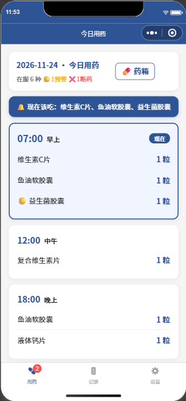
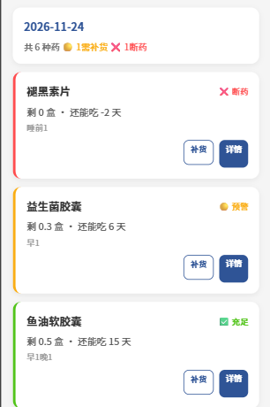
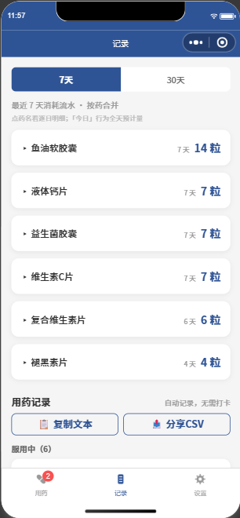
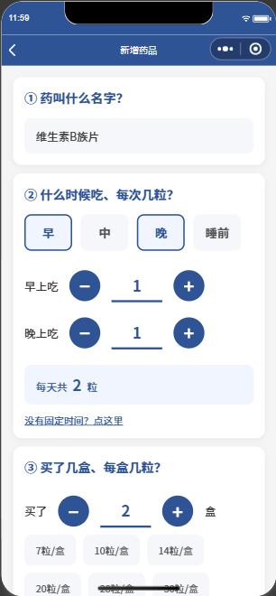
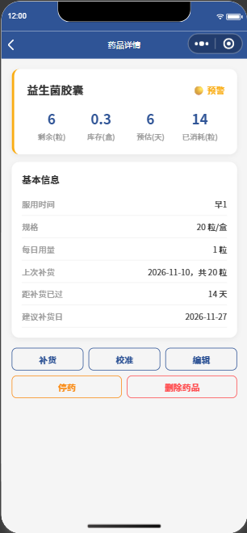

# 还剩几粒 · PillsLeft

> 家庭用药管理微信小程序。**用数学替代打卡**：库存是时间的函数，不是用户操作的函数。
>
> 记一次补货，自动算出每种药还剩几粒、哪天该买；今天该吃什么，打开一看就知道。

微信小程序「还剩几粒」已上线（2026 年 11 月发布，原名「清点助手」），在微信中搜索即可使用。本仓库是它的开源代码。

> *PillsLeft* is a WeChat mini program that works out how many pills are left from time and daily dose, so nobody has to check in every day.

## 界面预览

| 今日用药 | 药箱 | 记录 |
|---|---|---|
|  |  |  |

| 新增药品（三问式） | 药品详情 | |
|---|---|---|
|  |  | |

## 为什么做这个

家里药一多，三个问题总是答不上来：

- 这盒药还剩几粒？要倒出来数
- 什么时候该买？总是吃完了才发现
- 今天早中晚各该吃哪几种？靠脑子记

大多数用药 App 要求每天打卡，忘打一天数据就不可信了。「还剩几粒」换了个思路：**只在补货时记一次“买了几盒、每盒几粒”**，之后的剩余量由“补货时库存 − 已过天数 × 每日用量”实时算出，永远不需要打卡。

## 功能

| 功能 | 说明 |
|---|---|
| 剩余药量推算 | 剩余粒数 / 盒数 / 可用天数实时计算；剩余 ≤7 天预警，耗尽标红 |
| 今日用药时刻表 | 按早 / 中 / 晚 / 睡前四时段分组，当前时段高亮；各时段的时刻可自定义 |
| 应用内提醒 | “现在该吃……”提示条；底部标签角标显示缺药数量 |
| 三问式录入 | 只回答三个问题：药名、何时吃每次几粒、买了几盒每盒几粒；以大号步进器为主，不用打开数字键盘也能填完 |
| 补货与校准 | 补货只问“又买了几盒”，校准只问“现在还剩几粒” |
| 停药与恢复 | 停药时选原因、库存推算冻结；可一键重新启用 |
| 用药记录 | 每种药的起止日期自动沉淀，无需手动记录；可复制文本或导出 CSV |
| 消耗流水 | 7 天 / 30 天消耗量自动派生，按药合并、可展开看逐日明细 |
| 备份与恢复 | 应用内一键全量备份 / 恢复，换手机不丢数据 |

## 特点

- **纯本地，无后端**：没有账号、没有网络请求，数据只存在用户手机里
- **领域逻辑全是纯函数**：库存推算、时段解析、记录导出都在 `src/utils/`，不依赖微信 API，可以直接用 Node 测试
- **零依赖**：小程序不引入任何 npm 包，测试只用 Node 内置的 `assert`
- **适老设计**：关键数字 20px 以上，步进器点选为主，药名可以用微信键盘的语音输入

## 本地运行

环境：[微信开发者工具](https://developers.weixin.qq.com/miniprogram/dev/devtools/download.html)（基础库 3.3.4）；Node.js ≥ 16（只在跑测试时需要）。

1. 克隆仓库

   ```bash
   git clone https://github.com/wj289521976/PillsLeft.git
   ```

2. 微信开发者工具 → 导入项目 → 选择**仓库根目录**（`project.config.json` 已把小程序根目录指向 `src/`）

3. 把 `project.config.json` 里的 `appid` 换成你自己的小程序 AppID（或选择测试号）

4. 编译，即可在模拟器中运行。首次打开是空药箱，点「添加第一种药」开始

## 测试

```bash
npm test        # 工程健康检查 + 全部单元测试
npm run check   # 仅工程健康检查
```

## 目录结构

```text
├── src/
│   ├── app.js / app.json / app.wxss
│   ├── pages/          # 用药（首屏）/ 记录 / 设置 / 药箱 / 新增 / 编辑 / 详情 / 补货 / 校准
│   ├── components/     # stepper 步进器
│   ├── utils/          # date · medicine（库存推算）· schedule（时段）· storage · records · logger
│   └── images/         # 底部标签栏图标
├── tests/              # 单元测试 + 工程健康检查（Node 直接运行，零框架）
├── scripts/            # 开发期脚本：标签图标生成、调试协议走查
├── docs/images/        # README 用截图
├── package.json        # 仅提供 npm test / npm run check 入口，不参与小程序运行
└── project.config.json
```

核心算法只有一行：`剩余粒数 = 补货时库存 − 已过天数 × 每日用量`。

## 说明

- 本工具只做数量与时间的推算和记录，**不提供任何用药建议**，请遵医嘱用药。
- 数据只存在本机，卸载小程序或清除微信缓存会丢失，请定期使用「设置 → 备份与恢复」。
- 源码中部分界面文案仍是旧名「清点助手」，将随后续版本更新。

## 许可证

[MIT](LICENSE)
